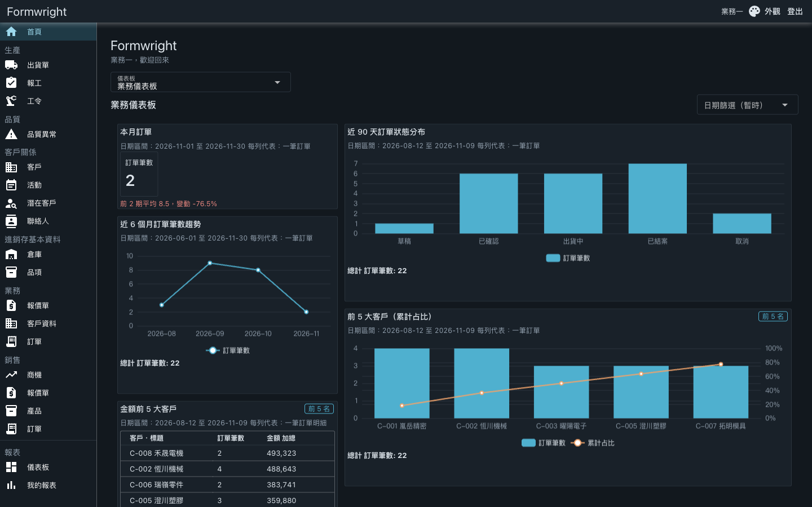
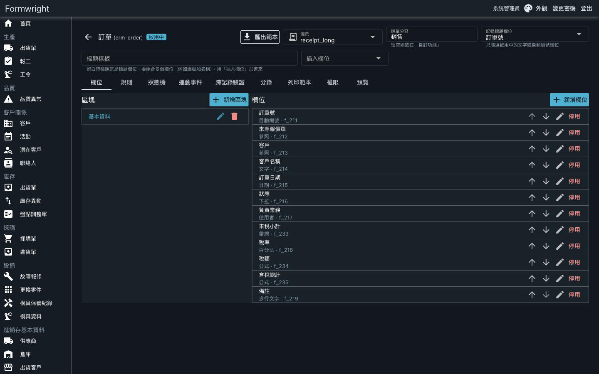
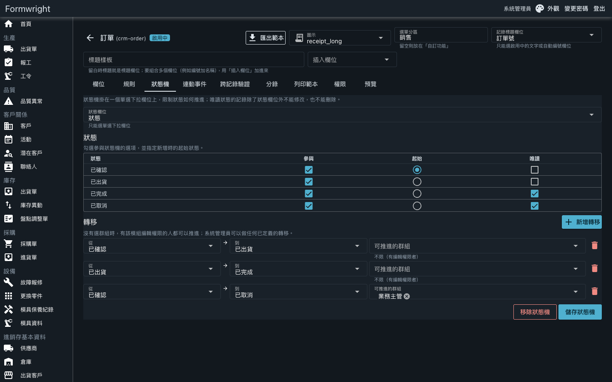
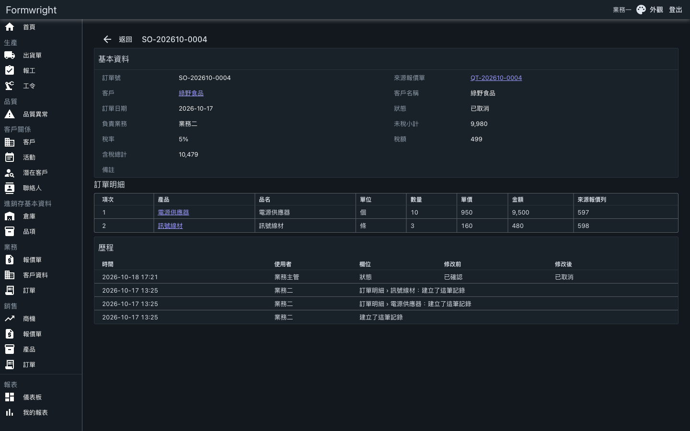

# Formwright

**Design your own inventory, CRM and production-management system, no coding required.**

[Live demo](https://dynamic-modules-demo.onrender.com) | [User manual](docs/manual.md) (zh-TW) | [Demo script](docs/demo.md) (zh-TW) | [繁體中文](README.md)



> **Try the demo**: on the login page, click one of the "Demo accounts" buttons to sign in instantly, no registration. The free host sleeps when idle, so the first load can take about 1 minute. Demo data is reset periodically; please do not enter real data. The demo UI is in Traditional Chinese by default; the language can be switched in the app.

## What it solves

Small and mid-sized companies often keep inventory, customers, work orders and quotes in spreadsheets and several unrelated systems. Off-the-shelf packages force you to bend your process to the software, and every change means calling the vendor.

Formwright lets you define modules and fields on screen, and the system generates the list, form, detail view, search and permissions for you. The built-in applications are made of the same definitions, so once enabled they can be reshaped to fit your own process.

It is aimed at small and mid-sized companies that want to own their business system, and at consultants who implement systems for clients.

## Built-in applications

Each application can be enabled on its own, or you can enable none and build up from an empty system.

| Application | Status | Contents |
|---|---|---|
| CRM and Sales | Done | Leads, customers and contacts, opportunities, activities; quote-to-order conversion, orders with line items and tax-inclusive totals |
| Inventory | Done | Items, warehouses, suppliers, purchase orders, receipts, shipments, stock movements and adjustments; stock is posted from documents |
| MES (mold shop) | Done | Quotes, orders, work orders and operations, production reports, shipments, quality issues, mold maintenance and repair requests |
| Accounting | Planned | Journal entries and income statement |
| HRM | Planned | Staff, leave and approvals |
| Project time tracking | Planned | Projects and timesheets |
| Service desk | Planned | Customer-service and IT tickets |

Planned items are not implemented yet; see the [ERP roadmap](docs/superpowers/specs/2026-11-06-erp-roadmap-design.md) (zh-TW) for order and scope.

## Platform capabilities

- **Module and field designer**: build modules, sections and 21 field types on screen without code; preview, export and import templates.
- **Rules and formulas**: show, require, read-only and validation conditions per field, formulas and auto-numbering, evaluated identically on the front end and back end.
- **Permissions and data scope**: group and per-user action permissions, data scope (all, own, same group), field-level permissions and option scopes.
- **State machines and document conversion**: define how a document moves between statuses and who may move it; a quote can be partially converted into an order with its source preserved.
- **Reports and dashboards**: reports that merge several modules, charts, drill-down and sharing; a 12-column drag-and-drop dashboard that can be embedded in the home page.
- **Import, export and history**: CSV import with preview and confirmation, CSV and Excel export, and a change history on every record.
- **Four languages**: the interface and module names support Traditional Chinese, English, Thai and Vietnamese.







## Quick start

**Live demo**: open [dynamic-modules-demo.onrender.com](https://dynamic-modules-demo.onrender.com) and click a demo account on the login page. A few examples:

| Account | What it can see |
|---|---|
| System administrator | Everything, including the module designer and user and group management |
| Sales 1, Sales 2, Sales manager | CRM and Sales, and MES quotes and orders |
| Warehouse, Purchasing, Inventory manager | Inventory receipts, issues, purchasing and stock |
| Production planner, Maintenance, QA | Work orders and reports, mold maintenance, quality issues |

The accounts appear on the login page under their Chinese display names. See the [demo script](docs/demo.md) (zh-TW) for the scenarios.

**Self-hosting**: use the container, two commands. Environment variables, volumes and production notes are in the [deployment guide](docs/deploy.md) (zh-TW).

```bash
cd poc && docker build -t dynamic-modules .
docker run -p 8080:8080 -e Auth__InitialAdminPassword=choose-a-password dynamic-modules
```

Open `http://localhost:8080` and sign in as `admin`.

## Current limitations

- The product is under active development; features and screens will keep changing.
- Only SQLite is supported for now.
- The backend assumes a single instance per customer and cannot scale out horizontally.
- The Thai and Vietnamese UI text is machine-translated and needs native-speaker review before real use.
- The demo runs on a free host: it sleeps when idle and its data is reset, so it is for trying only.

## Tech

.NET 8, Vue 3 + Quasar, SQLite.

## Documentation and feedback

- [User manual](docs/manual.md) (zh-TW): login, designer, formulas and rules, permissions, reports and dashboards
- [Demo script](docs/demo.md) (zh-TW): which identity to use for each scenario
- [Deployment guide](docs/deploy.md) (zh-TW): demo deployment, container, environment variables
- [Contributing](CONTRIBUTING.md) (zh-TW): local setup, tests, directory layout
- Questions and suggestions: [GitHub Issues](https://github.com/KerryHuang/dynamic-fields-design/issues)

## License

Source is available for evaluation. © 2026 Kerry, all rights reserved. For commercial licensing or implementation, please get in touch through GitHub Issues.
