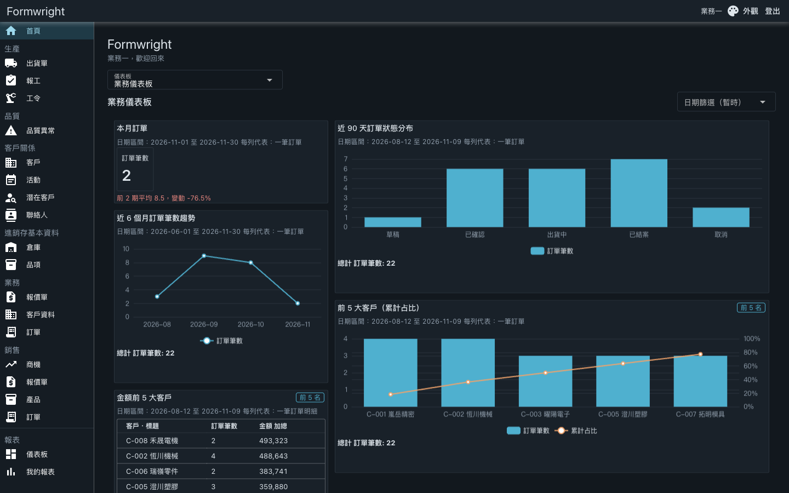
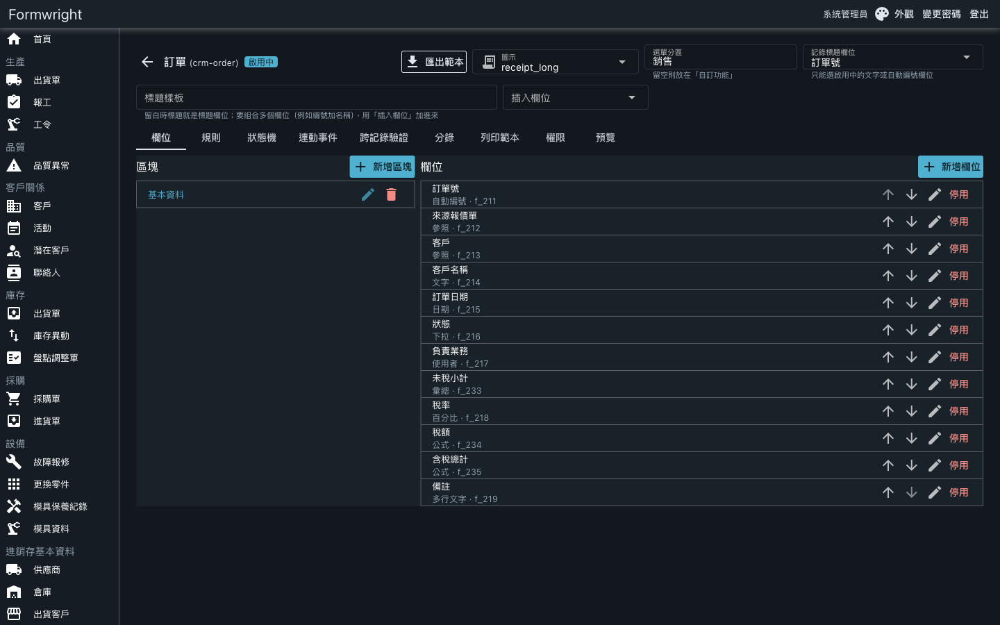
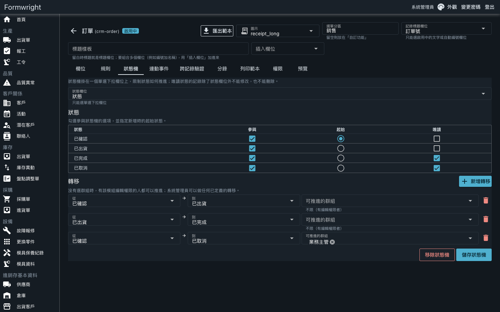
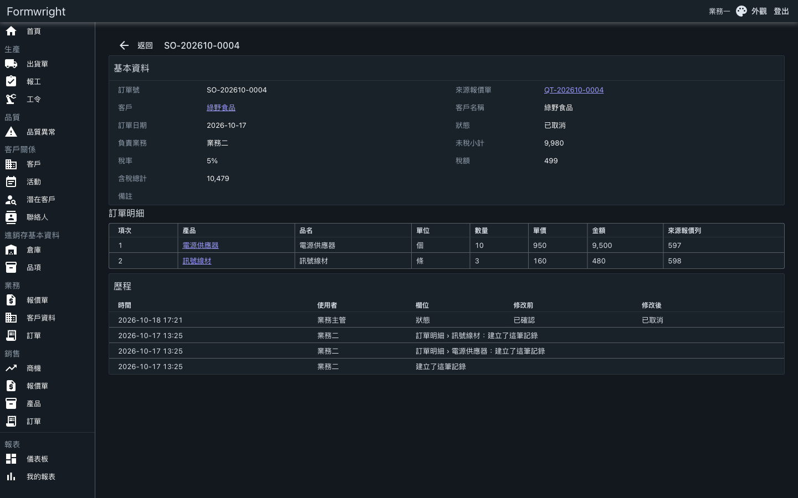

# Formwright 表匠

**不寫程式，自己設計進銷存、CRM 與生產管理的業務系統。**

[線上 Demo](https://dynamic-modules-demo.onrender.com)｜[操作手冊](docs/manual.md)｜[Demo 腳本](docs/demo.md)｜[English](README.en.md)



> **試用 Demo**：登入頁點「Demo 帳號」的按鈕就能一鍵登入，不用註冊。免費主機閒置會休眠，第一次開啟約需 1 分鐘。示範資料會定期還原，請勿輸入真實資料。

## 它解決什麼

中小企業的進銷存、客戶、工令與報價，常散在 Excel 與幾套各自獨立的系統裡；買現成套裝，流程又要遷就軟體，每次調整都得找開發商。

Formwright 讓你在畫面上自己定義模組與欄位，系統自動長出列表、表單、明細、查詢與權限。內建的應用程式也只是這些定義組成的，打開之後可以直接改成自己公司的流程。

適合想自己掌握業務系統的中小企業，以及替客戶導入系統的實作顧問。

## 內建應用程式

每個應用程式可以單獨開啟，也可以全部不開，從空白系統自己建起。

| 應用程式 | 狀態 | 內容 |
|---|---|---|
| CRM 與銷售 | 已完成 | 潛在客戶、商機、互動紀錄、行銷活動（建立時自動派工）；客戶與聯絡人改用共用主檔「往來對象」「聯絡人」；報價單轉訂單，訂單帶明細與含稅金額 |
| 進銷存 | 已完成 | 品項、倉庫、採購單、進貨單、出貨單、庫存異動與盤點調整，庫存由單據過帳；供應商、客戶與聯絡人用共用主檔「往來對象」「聯絡人」 |
| MES 模具廠 | 已完成 | 報價、訂單、工令與製程、報工、出貨、品質異常，以及模具保養與故障報修；客戶用共用主檔「往來對象」 |
| 會計 | 規劃中 | 傳票與損益表 |
| HRM | 規劃中 | 人員、請假與簽核 |
| 專案工時 | 規劃中 | 專案與工時紀錄 |
| 客服工單 | 規劃中 | 客服與 IT 工單 |

規劃中的項目還沒有實作，順序見 [路線與進度](docs/roadmap.md)，範圍見 [ERP 路線設計](docs/superpowers/specs/2026-11-06-erp-roadmap-design.md)。

## 平台能力

- **模組與欄位設計器**：在畫面上建模組、區塊與 21 種欄位，不用寫程式；可預覽、匯出與匯入範本。
- **規則與公式**：欄位的顯示、必填、唯讀與驗證條件，公式與自動編號，前後端用同一套判斷。
- **權限與資料範圍**：群組與個人的動作權限、資料範圍（全部、本人、同群組）、欄位權限與選項範圍。
- **狀態機與單據轉換**：規定單據狀態怎麼推進、誰能推進；報價單可部分轉成訂單並保留來源。
- **任務與通知**：任務可掛在任何記錄上或當個人待辦，留言可 @ 同事、附檔；任務規則依記錄的日期與負責人自動派工；右上角鈴鐺的站內通知與到期提醒。
- **報表與儀表板**：多模組合併的報表與圖表、下鑽、分享；12 欄拖放的儀表板，可嵌在首頁。
- **匯入匯出與歷程**：CSV 匯入先預覽再確認，CSV／Excel 匯出，每筆記錄的修改歷程。
- **四語系**：介面文案與模組、欄位名稱都備有繁中、English、ไทย、Tiếng Việt 四種版本。







## 快速試用

**線上 Demo**：開 [dynamic-modules-demo.onrender.com](https://dynamic-modules-demo.onrender.com)，在登入頁點一個 Demo 帳號即可。幾個例子：

| 帳號 | 看得到什麼 |
|---|---|
| 系統管理員 | 全部功能，含動態模組設計與使用者、群組管理 |
| 業務一、業務二、業務主管 | CRM 與銷售、MES 的報價與訂單 |
| 倉管人員、採購人員、進銷存主管 | 進銷存的收發料、採購與庫存 |
| 生管人員、保養人員、品保人員 | 工令與報工、模具保養、品質異常 |

各情境怎麼走見 [Demo 腳本](docs/demo.md)。

**自己架設**：用容器，兩條指令。環境變數、volume 與正式環境注意事項見[部署指南](docs/deploy.md)。

```bash
cd poc && docker build -t dynamic-modules .
docker run -p 8080:8080 -e Auth__InitialAdminPassword=請改成你的密碼 dynamic-modules
```

開 `http://localhost:8080`，以 `admin` 登入。

## 目前限制

- 產品仍在開發中，功能與畫面會持續調整。
- 目前只支援 SQLite；其他資料庫尚未支援。
- 後端假設每家客戶只跑一個 instance，還不能水平擴充。
- 介面語言可在登入頁與右上角切換（繁中、English、ไทย、Tiếng Việt），選擇記在該瀏覽器；ไทย 與 Tiếng Việt 的文案是機器翻譯，正式使用前需要母語人士校對。
- Demo 跑在免費主機上，會休眠、資料會還原，只適合試用。

## 技術

.NET 8、Vue 3 + Quasar、SQLite。

## 文件與回報

- [操作手冊](docs/manual.md)：登入、設計器、公式與規則、權限、報表與儀表板
- [Demo 腳本](docs/demo.md)：每個情境用哪個身分、示範哪項能力
- [部署指南](docs/deploy.md)：Demo 部署、容器、環境變數
- [開發指南](CONTRIBUTING.md)：本機啟動、測試、目錄結構
- 問題與建議：請到 [GitHub Issues](https://github.com/KerryHuang/dynamic-fields-design/issues)

## 授權

原始碼公開供評估。© 2026 Kerry，保留所有權利；如需商業授權或導入，請到 GitHub Issues 聯絡。
