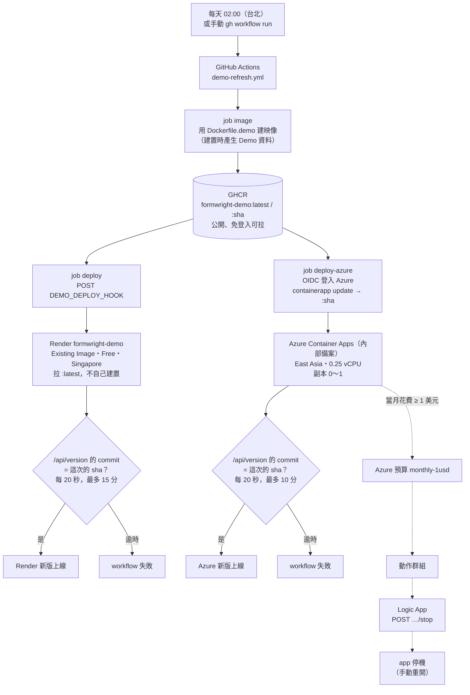

# 部署與環境變數

Formwright 的 Demo 站與容器部署做法。本機開發與測試見 [CONTRIBUTING.md](../CONTRIBUTING.md)；操作畫面見[操作手冊](manual.md)。

## Demo 部署（GHCR 映像＋託管平台拉映像）

`Dockerfile.demo` 把前端建置結果、後端與建置時產生的 Demo 資料打包成一個容器，API 與畫面在同一個網址。Render 免費方案每月的建置額度不夠用，所以改成由 GitHub Actions 建好映像推上 GHCR，託管平台只拉現成映像、不自己建置（使用者 2026-11-20 裁決）。目前 Render（公開 Demo）與 Azure Container Apps（內部備案）同步部署。

### 部署架構

原本由 Render 從 git 自己建置，推上 `main` 就自動部署。2026-11 本月 Render 建置額度用完，改成 GitHub Actions 每天建映像推上 GHCR，Render 與 Azure 備案拉同一份映像同步部署（使用者 2026-11-20 裁決）。推上 `main` 不再部署。



| | Render（公開 Demo） | Azure（內部備案） |
|---|---|---|
| 角色 | 公開 Demo | 內部備案 |
| 區域 | Singapore | East Asia |
| 休眠 | 閒置 15 分 | 閒置約 6.5 分縮到 0 |
| 喚醒 | 約 1 分鐘 | 約 27 秒 |
| 費用 | 免費 | 免費額度內，每月約 200 小時；超過 1 美元自動停機 |

1. 映像：`ghcr.io/kerryhuang/formwright-demo`，標籤有 `latest` 和 commit sha。託管平台要能拉得到：把 GHCR package 設成公開，或在平台設定 registry 認證。
2. 託管平台：建一個「從映像部署」的服務，映像填 `ghcr.io/kerryhuang/formwright-demo:latest`、健康檢查路徑 `/api/health/ready`，關掉 Auto-Deploy；把平台的 Deploy Hook 網址設成 GitHub secret `DEMO_DEPLOY_HOOK`。

目前的 Demo：<https://formwright-demo.onrender.com>，Render 與 Azure 同步部署（2026-11-20 run 44700316887 起）。

- **Render 服務 `formwright-demo`**：Existing Image 服務（拉 `ghcr.io/kerryhuang/formwright-demo:latest`），Free 方案、Singapore 區，健康檢查 `/api/health/ready`。環境變數三個：`Demo__LoginEnabled=true`、`Auth__TrustForwardedHeaders=true`、`Auth__ClientIpHeader=True-Client-IP`（登入限流讀 Cloudflare 填的來源 IP）。2026-11-20 本月建置額度已用完，拉映像部署仍成功；尚未在 Render 用量頁確認是否計入建置分鐘。
- **舊服務** `dynamic-modules-demo`（舊的 git 建置服務）：已在 Render 暫停（Suspend，使用者 2026-11-20 裁決），舊網址回 503；要恢復到該服務的 Settings 按 Resume。

限制：免費方案閒置 15 分鐘會休眠，下次開啟要等約 1 分鐘；沒有永久磁碟，休眠重啟後資料回到映像建置時的 Demo 資料（`Dockerfile.demo` 在建置時就產生好，喚醒後不用等），日期停在建置那天，每天的排程部署會更新。Demo 站開了一鍵登入（`Demo__LoginEnabled`），任何人點一下就能以任何 Demo 帳號含 `admin` 登入，所以站上只放虛構的示範資料，請勿輸入真實資料。Render 上 cookie 帶 `secure; samesite=lax; httponly`（2026-11-05 實測）。

啟動時自動產生 Demo 資料：設定環境變數 `Demo__SeedOnStartup=true`，站台會在背景產生訂單、故障報修、模具保養、品質異常四組模組與範例記錄；本機預設關閉，Demo 映像改在建置時產生，不需要這個設定。也可以由系統管理員在「系統管理 → Demo 資料」手動產生。各情境怎麼示範見 [Demo 腳本](demo.md)。

### Demo 每日部署

推上 `main` 不會部署。`.github/workflows/demo-refresh.yml` 每天台北時間 02:00（UTC 18:00）跑一次，不判斷當天有沒有改動，順便讓 Demo 資料的日期每天更新：

1. 用 `Dockerfile.demo` 建映像（build-arg `GIT_COMMIT` 是這次的 sha），推上 GHCR 的 `latest` 與 `<sha>`。
2. 呼叫 `DEMO_DEPLOY_HOOK`，接著每 20 秒讀一次 `<DEMO_URL>/api/version`，`commit` 等於這次的 sha 才算成功，最多等 15 分鐘，逾時讓排程失敗。部署期間舊實例會繼續服務，只看健康檢查分不出新舊版，所以比對 commit。

設定：

- secret `DEMO_DEPLOY_HOOK`：託管平台的 Deploy Hook 網址（GitHub repo → Settings → Secrets and variables → Actions → Secrets）。沒設定時只建映像、印警告、照樣成功結束；有設定時先去掉前後空白與換行，不是 `https://` 開頭就報錯讓排程失敗。舊 secret `RENDER_DEPLOY_HOOK` 已於 2026-11-20 刪除。
- variable `DEMO_URL`：Demo 站網址（同一頁的 Variables），沒設定時用 `https://formwright-demo.onrender.com`。

GitHub Deployments：Render 的部署寫入環境 `demo`（附 Demo 網址）；舊環境 `main - dynamic-modules-demo` 是舊服務的 Render 整合留下的歷史紀錄。Azure 備案刻意不寫入：它是不公開的內部備案，不放進公開的 Deployments（使用者 2026-11-20 裁決）。若日後要加，需先在 Azure 新增 subject 為 `repo:<owner>@<owner-id>/<repo>@<repo-id>:environment:demo-azure` 的聯合憑證，否則 OIDC 登入會失敗（現有憑證只認 `ref:refs/heads/main`）。

急著上線：`gh workflow run demo-refresh.yml`（或 GitHub → Actions → demo-refresh → Run workflow），不必等到隔天 02:00。

### Azure Container Apps 備案

同一個映像另外部署一份到 Azure Container Apps 當備案（使用者 2026-11-20 裁決），由 `demo-refresh.yml` 的 `deploy-azure` job 和 `deploy` 並列執行，每天跟著排程更新。

- 資源：資源群組 `formwright-demo-rg`、Container App `formwright-demo`，區域 `eastasia`，0.25 vCPU／0.5Gi，最少 0、最多 1 個副本，不接 Log Analytics。縮到 0 後第一個請求冷啟動約 27 秒。
- 費用：用 Container Apps 的每月免費額度，以這個規格約可運作 200 小時；閒置時縮到 0 不計費。
- 費用保護：預算 `monthly-1usd`（每月 1 美元）。實際花費達 80% 寄信、預估超過 100% 寄信；實際達 100% 時，預算觸發動作群組 `formwright-demo-stop`，由 Logic App `formwright-demo-stop` 以受控識別 POST Container App 的 `/stop` 停機（受控識別只授權到這個 app）。
  - 費用資料約延遲一天，可能小幅超過預算。
  - 停機後備案就沒了，要手動重開（az 2.90 沒有 `containerapp start` 子指令）：`az rest --method post --url "https://management.azure.com/subscriptions/<訂閱 ID>/resourceGroups/formwright-demo-rg/providers/Microsoft.App/containerApps/formwright-demo/start?api-version=2024-03-01"`。
  - 2026-11-20 實測：Logic App 觸發後 20 秒內停機，重開正常；預算到 100% 的整條鏈還沒真的觸發過。
- 身分：GitHub OIDC（不存 client secret），聯合憑證只允許本 repo 的 `main` 分支，角色只授予這個 Container App。聯合憑證的 subject 要用 GitHub 的新格式 `repo:<owner>@<owner-id>/<repo>@<repo-id>:ref:refs/heads/main`；用舊格式 `repo:<owner>/<repo>:ref:...` 會登入失敗（AADSTS700213）。
- job 步驟：`azure/login` 登入 → `az containerapp update` 把映像換成 `ghcr.io/kerryhuang/formwright-demo:<sha>` → 每 20 秒讀一次 `<DEMO_AZURE_URL>/api/version`，`commit` 等於這次的 sha 才算成功，最多 10 分鐘，逾時讓 job 失敗。

設定（GitHub repo → Settings → Secrets and variables → Actions）：

- secrets `AZURE_CLIENT_ID`、`AZURE_TENANT_ID`、`AZURE_SUBSCRIPTION_ID`：OIDC 身分的識別碼。`AZURE_CLIENT_ID` 沒設定時 job 印警告、略過部署、照樣成功結束。
- variable `DEMO_AZURE_URL`：備案站網址（不含結尾斜線）；網址不公開，只存在這個 variable。

## 環境變數

| 變數 | 用途 |
|---|---|
| `Auth__InitialAdminPassword` | 全新安裝時 `admin` 的初始密碼（至少 8 碼）；沒設就產生隨機密碼，印在啟動 log |
| `Auth__ResetAdminPassword` | 緊急救援：啟動時重設 `admin` |
| `Auth__ClientIpHeader` | 反向代理後面時，登入限流改讀這個標頭的來源 IP（須是代理自己填、不接受客戶端帶入的標頭，如 `True-Client-IP`）；沒設就用連線來源，所有人會共用一個額度 |
| `Auth__TrustForwardedHeaders` | 在反向代理後面時設 `true`，cookie 才會加 `Secure` |
| `Demo__LoginEnabled` | 登入頁列出 Demo 帳號一鍵登入 |
| `Demo__SeedOnStartup` | 啟動時背景產生 Demo 資料 |
| `Attachments__Root` | 附件存放目錄；沒設就放在資料庫旁的 `attachments`（記憶體資料庫放暫存目錄） |
| `Attachments__UploadEnabled` | 是否開放上傳；沒設時 `Demo__LoginEnabled` 為 `true` 就關閉，否則開放 |
| `Localization__PackImportEnabled` | 是否開放匯入語系包（套用、回到上一版、移除覆寫、移除語系）；沒設時 `Demo__LoginEnabled` 為 `true` 就關閉（只能預覽報告），否則開放 |
| `Attachments__DisabledReason` | 關閉上傳時顯示給使用者的原因 |
| `Attachments__MaxBytes`、`Attachments__MaxFilesPerField`、`Attachments__AllowedExtensions__0`… | 附件政策在這個環境的出廠值，見下方「附件設定與政策出廠值」 |
| `Ops__Edition` | 版別，`Cloud` 或 `OnPrem`（其他值記 Warning 並當 `OnPrem`）；顯示在系統管理員的 ops info |
| `Ops__TrustIncomingTraceParent` | 預設 `false`：忽略外來的 `traceparent`，request id 由伺服器產生；放在自家反向代理後面、要串接上游 trace 時才設 `true` |
| `Ops__Scheduler__Enabled` | 背景排程器（通知維護等），預設 `true`；設 `false` 整個不跑。多實例時同一工作靠資料表租約只跑一份，也可以只讓其中一台開著；實例之間的時鐘誤差由 5 分鐘租約吸收，主機請開 NTP 校時 |
| `Sqlite__MmapSizeMb` | SQLite 每條連線的記憶體對映大小，單位 MB，預設 `0`（關閉）；也可寫在 `appsettings.json` 的 `Sqlite:MmapSizeMb` |
| `Database__Provider` | 資料庫種類：`Sqlite`（預設）或 `Postgres`，其他值拒絕啟動。`Postgres` 時 `ConnectionStrings__Dynamic` 是 Npgsql 連線字串，目標資料庫要先建好（不存在就拒絕啟動，系統不代建）。報表在兩種資料庫行為相同（能在資料庫端聚合就走 SQL 路徑） |
| `Database__LockTimeoutSeconds` | 只在 `Postgres` 生效：寫入排隊與全庫寫入鎖各自的等待上限（秒），預設 `30`，逾時回 503；`0` 是不設上限 |
| `DataProtection__KeysDirectory` | 登入 cookie 加密金鑰的存放目錄（相對路徑以站台目錄解析）；沒設就放在資料庫檔案旁的 `keys`，記憶體資料庫與 PostgreSQL 則不落地（重啟後要重新登入，PostgreSQL 會記 Warning） |

`Auth__InitialAdminPassword` 只在資料庫還沒有可用的管理員時有效，之後改它不會覆寫既有密碼。`Auth__ResetAdminPassword` 至少 8 碼，會重設 `admin` 的密碼、啟用、解鎖、要求改密碼並讓所有 session 失效；救回後要把它移除，否則每次重啟都會再重設。`Demo__LoginEnabled` 絕不能在正式站開啟，它不驗密碼。Swagger 只在 Development 環境開放。

`Sqlite__MmapSizeMb` 是大型部署的效能設定，用在資料庫檔案達數 GB、查詢以索引篩選為主的站台：負載測試中索引型查詢單人快 30% 至 45%（[儲存層負載報告](superpowers/specs/2026-11-06-storage-load-report.md) §5）。對映大小要接近資料庫檔案的大小才有效果（只開 256 MB 對 3 GB 的資料庫看不出差別），數值大於檔案時只會用到檔案那麼多；代價是占用位址空間，頁面快取由作業系統管理，實體記憶體不足的主機請維持關閉。設定逐連線生效，改值後要重啟站台；0、負數與非數字都視為關閉。只有 SQLite 會套用。

## 附件設定與政策出廠值

`Attachments` 節（環境變數寫成 `Attachments__名稱`，也可寫在 `appsettings.json`）分兩類：

- **部署設定**：`Root`、`UploadEnabled`、`DisabledReason`，只能在這裡設定。
- **政策出廠值**：`MaxBytes`（單檔大小，位元組）、`MaxFilesPerField`（每個附件欄位的檔案數）、`AllowedExtensions`（副檔名白名單，陣列；環境變數用 `Attachments__AllowedExtensions__0`、`__1`…）。有寫才算，沒寫用程式出廠值。這幾個值是該環境的**出廠值**，系統管理員可以在「系統管理 → 政策設定」覆蓋它（單檔大小、檔案數也可以再由模組覆寫）；畫面上按「恢復出廠值」回到這裡的值。改設定檔要重啟站台才會生效。

政策有技術上下限（單檔 1 到 52428800 位元組、每欄位 1 到 100 個檔案、白名單最多 40 個）。設定檔的值超出範圍時，啟動會記一則 Warning 並夾到上下限（例如 `MaxBytes=999999999` 會變成 52428800）；非數字的值記 Warning 並改用程式出廠值。白名單裡的網頁、腳本與可執行檔副檔名（html、svg、js、exe 等，完整清單見[操作手冊](manual.md#系統管理政策設定)）不論誰設都不收：設定檔裡的這類項目會被丟掉並記 Warning。

## log、健康檢查與版本

- **log**：非開發環境輸出 JSON 到 stdout（`appsettings.json` 的 `Logging:Console`），由 Docker、systemd 或 Windows 服務包裝程式收集；開發環境維持純文字。4xx、5xx 與超過慢請求門檻的請求結束時記一行（只用路由樣板，不記查詢字串）；一般成功的請求是 Debug，預設不輸出，要看時設 `Logging__LogLevel__DynamicModules.WebAPI.Ops=Debug`，同一個請求的所有 log 都帶 `requestId` 欄位，回應標頭 `X-Request-Id` 與錯誤回應主體的 `traceId` 是同一個值。框架自帶的 `RequestId` 欄位（連線序號格式）是另一個東西，查同一請求請用 `requestId`。慢請求門檻在「系統管理 → 政策設定」。
- ⚠️ **產品 log 可能含例外原文**：框架的例外訊息可能帶輸入值，前端錯誤回報也會把原始訊息與 stack 記進 log，所以 log 視同敏感資料控管存取。
- **健康檢查**：`/api/health/live`（程序活著）、`/api/health/ready`（資料庫可連線，逾時 2 秒回 503）、`/api/health`（同 live，相容舊設定）。Render 與 Azure 的健康檢查都設 `/api/health/ready`。
- **版本**：`GET /api/version` 回 `version`、`commit`、`builtAt`。Docker build-arg `APP_VERSION`、`GIT_COMMIT`（沒給時退回 Render 的 `RENDER_GIT_COMMIT`）、`BUILD_TIME`（沒給時用建置當下）注入；沒注入的欄位顯示 `dev`。原始碼沒變時 Docker 沿用快取層，`builtAt` 可能停在舊時間。
- **自訂指標**：目前沒有匯出端；要看用 `dotnet-counters monitor --counters Formwright`（執行次數、前端錯誤收件數、規則失敗數）。

## 單一 instance 與 volume

登入失敗計數用程序內的鎖保護，假設每家客戶只跑一個後端 instance。Docker 部署要把資料庫目錄（`/app/data`）掛成 volume，登入金鑰才會保留。

⚠️ 已知限制：資料庫持續讀不到時，政策設定（含營運時區與語系）沿用上次成功讀到的值、沒有時間上限；站台啟動時就讀不到資料庫則先用出廠值，恢復後最多 10 秒重新讀取。

⚠️ 多台部署：全系統政策（含維運政策與營運時區）每台各自快取，在別台改的值最多 60 秒後才在這台生效（與 O1 的維運政策快取是同一份）。改營運時區的那一刻，其他台在這段時間內用舊時區寫入的日期時間索引會永久差一段時差，所以**改時區請在離峰時段、先縮成一台再改**，改完再擴回多台。

## 本機試跑容器

容器以 Production 環境執行，`admin` 沒有預設密碼：請加 `-e Auth__InitialAdminPassword=...`，或從啟動 log 找隨機密碼。

```bash
docker build -t dynamic-modules . && docker run -p 8080:8080 dynamic-modules
```

開 `http://localhost:8080`。
